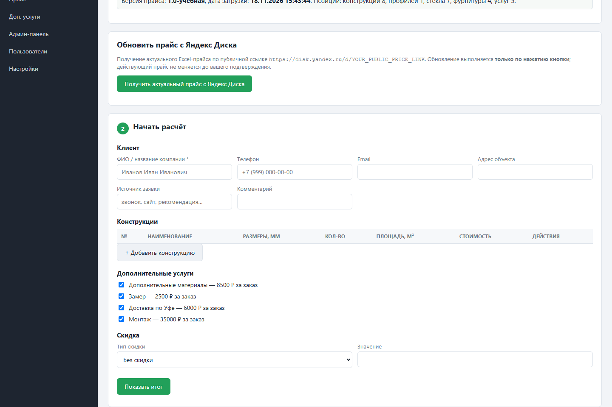
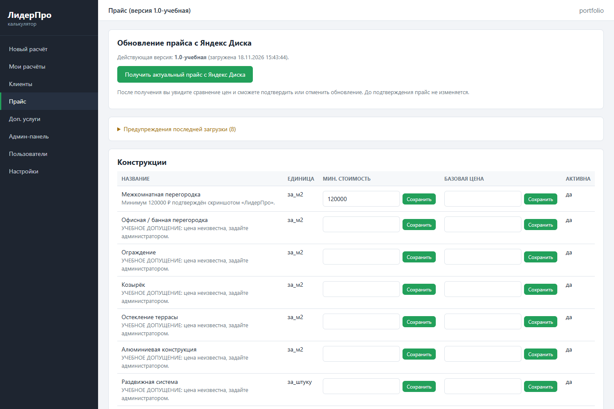

<!-- portfolio-case:v1 -->
# Калькулятор стоимости конструкций

Локальное приложение: несколько конструкций в одном расчёте, услуги и скидки, история с зафиксированными ценами, обновление прайса и экспорт.

[Все проекты](https://github.com/gek-finn)

## Задача

Рассчитывать стоимость конструкций по единому прайсу и сохранять понятную расшифровку для клиента.

## Что реализовано

- Учётные записи администратора и сотрудников.
- Загрузка и проверка Excel-прайса; обновление по публичной ссылке Яндекс Диска после настройки.
- Стекло, профиль, фурнитура, размеры, услуги и скидки.
- Снимки цен в истории и пересчёт новой версии расчёта.
- Экспорт PDF / Excel и подготовка Windows-сборки.

## Технологии

Python · Flask · SQLite · JavaScript · openpyxl · PyInstaller

## Статус и ограничения

Учебная реализация по мотивам открытого заказа FL.ru №5521084. Часть правил и тарифов — учебные допущения. Онлайн-развёртывание в этот кейс не входит.

## Интерфейс

### Создание расчёта

### Работа с прайсом

### Мобильный экран

## Запуск

[Инструкция установки и запуска](docs/SETUP.md).

## О кейсе

Описание показывает реализованные функции. Подтверждённые показатели продаж, экономии времени и коммерческого внедрения в этом кейсе не заявляются.
